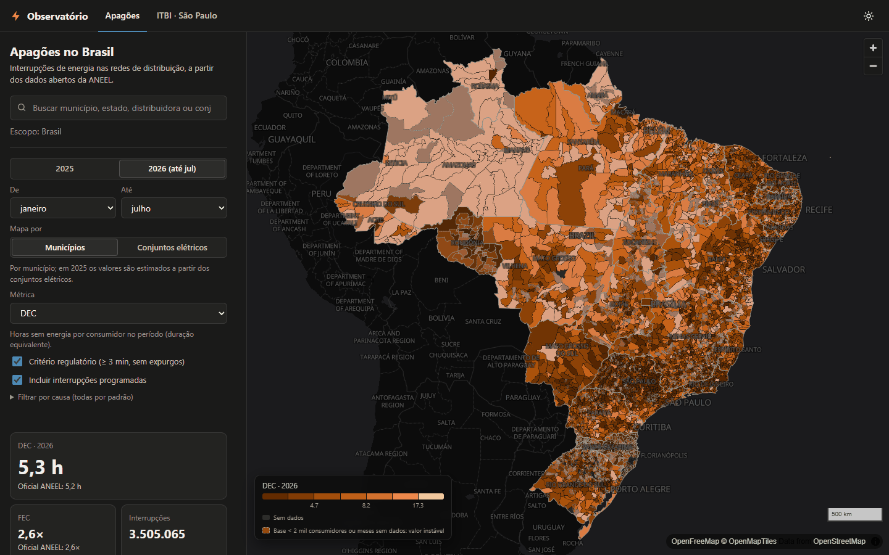
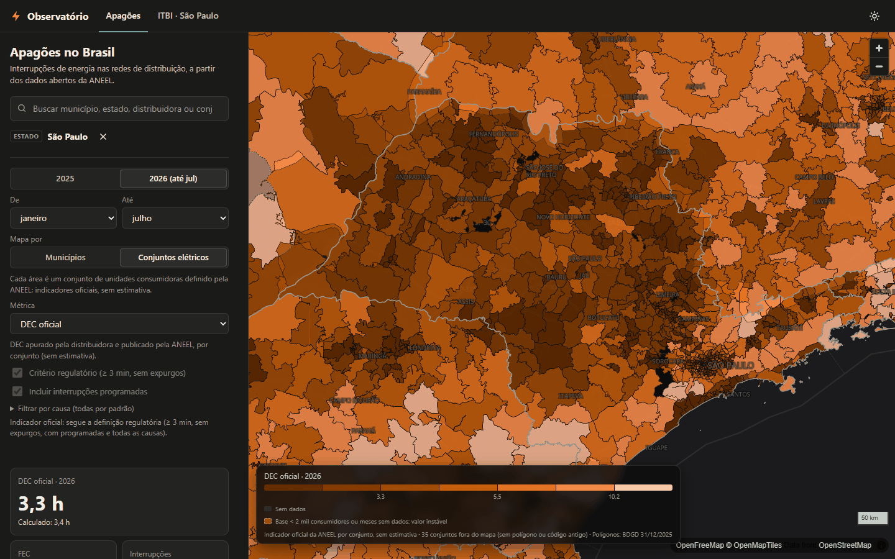
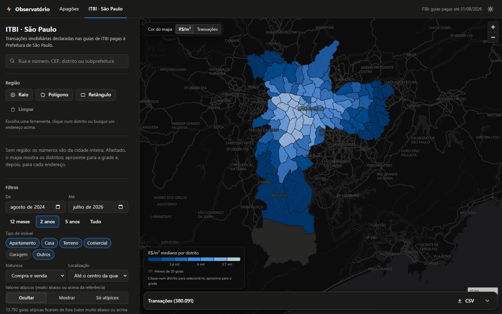
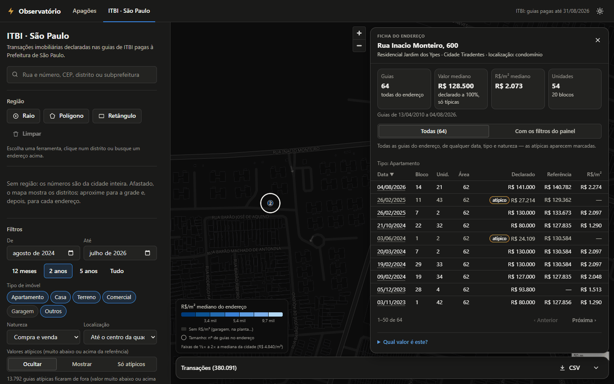

# Observatório — apagões (ANEEL) e ITBI (São Paulo)

Onde falta energia no Brasil e por quanto se vendem os imóveis em São Paulo — em mapa, a partir
de dados abertos oficiais, sem cadastro e sem chave de API.



## Funcionalidades

### Apagões (ANEEL)

Interrupções de energia nas redes de distribuição
([ANEEL](https://dadosabertos.aneel.gov.br/dataset/interrupcoes-de-energia-eletrica-nas-redes-de-distribuicao)),
ano corrente e anterior, mês a mês.

* **Mapa por município**: DEC, FEC, CHI, consumidores afetados, interrupções e duração média.
  Em 2025 a fonte não traz o município, e os valores são estimados a partir dos conjuntos
  elétricos (a tela sinaliza).
* **Mapa por conjunto elétrico** — o recorte em que a ANEEL publica os indicadores: DEC/FEC
  calculados das interrupções de cada conjunto ao lado do **DEC/FEC oficial**, sem estimativa
  (polígonos da BDGD).
* Busca por município, estado, distribuidora ou conjunto, com autocompletar; para o recorte
  escolhido, evolução mensal, calculado × oficial, causas, ranking dos municípios ou conjuntos
  com maior valor da métrica e as maiores interrupções. Meses que faltam nos arquivos da ANEEL ficam marcados, sem virar
  zero.



### ITBI São Paulo

Guias de ITBI pagas
([Prefeitura de SP](https://prefeitura.sp.gov.br/web/fazenda/w/acesso_a_informacao/31501)),
de 2015 até hoje, **geocodificadas** pelo cadastro de lotes do GeoSampa.

* **Mapa em três níveis**: de longe, os distritos coloridos pelo R$/m² mediano ou pelo número de
  transações; ao aproximar, uma grade com o número de guias; de perto, um ponto por endereço
  (lote ou condomínio).
* Região por raio a partir de um endereço, por polígono ou retângulo desenhado ou por
  distrito/subprefeitura. Filtros por período, tipo de imóvel, natureza, valor, área e precisão
  da localização.
* **Valor declarado × referência**: o valor declarado, levado a 100% do imóvel, aparece ao lado
  do valor venal de referência da Prefeitura. Declarações muito abaixo ou acima da referência
  são marcadas como **atípicas** e ficam fora das medianas por padrão; dá para incluí-las ou
  vê-las sozinhas.
* **Ficha do endereço**: todas as guias do lote ou condomínio (de qualquer data, tipo e
  natureza), com bloco/torre, unidade, vagas, declarado, referência e R$/m², e a contagem de
  unidades e blocos. A busca aceita "Rua X, 600" e abre direto a ficha do número.
* Mediana de R$/m², séries mensais, ranking dos distritos, tabela de transações e exportação
  CSV.





### Para todos

* **Links compartilháveis**: o estado da tela vai no endereço. Tema escuro por padrão, basemap
  do [OpenFreeMap](https://openfreemap.org) (sem chaves de API), tabelas como alternativa
  acessível aos gráficos e API JSON documentada em `/api/docs`.
* **Dados em dia**: a ingestão é incremental (só baixa e reprocessa o que mudou nas fontes), e
  uma Action do GitHub publica todo mês um pacote de dados pronto.
* **Publicação**: o servidor baixa e instala sozinho esse pacote (`.tar` com sha256) na partida.
  A imagem Docker roda no Hugging Face Spaces, no Cloud Run ou num servidor qualquer.

## Requisitos

* [uv](https://docs.astral.sh/uv/) (instala o Python 3.13 sozinho) — ou só o Docker
* Internet na primeira ingestão (~1,4 GB de downloads, ~4 min de processamento) e para os
  mapas de fundo
* ~2 GB de RAM livres para o servidor (o ITBI é carregado em memória e comprimido)

## Começando

### Com uv

```bash
uv sync
uv run observatorio ingest all
uv run observatorio serve
```

Abra <http://127.0.0.1:8000>. A documentação interativa da API fica em `/api/docs`.

Sem ingerir (usa o pacote de dados já publicado, ~590 MB):

```bash
uv run observatorio bundle baixar https://github.com/rafaelgfig/observatorio/releases/download/dados/observatorio-dados.tar
uv run observatorio serve
```

### Com Docker

```bash
docker build -t observatorio .
docker run --rm -p 7860:7860 \
  -e OBSERVATORIO_BUNDLE_URL=https://github.com/rafaelgfig/observatorio/releases/download/dados/observatorio-dados.tar \
  observatorio
```

Abra <http://localhost:7860>. O contêiner sobe na hora e baixa os dados em segundo plano;
enquanto isso, uma página de espera mostra o andamento e abre o site sozinha quando os dados
chegam.

### Atualizar os dados

`ingest` é **incremental**: guarda ETag/Last-Modified e o hash de cada arquivo em
`data/manifest/` e só reprocessa o que mudou. No ITBI, cada mês é uma partição — quando a
prefeitura publica um novo mês no arquivo do ano corrente, só esse mês é gravado. Rodar de novo
sem novidades leva segundos. Com o servidor no ar, ele recarrega os dados sozinho ao fim da
ingestão.

```bash
uv run observatorio ingest itbi          # só o ITBI
uv run observatorio ingest aneel --year 2026
uv run observatorio ingest all --force   # reprocessa tudo
uv run observatorio status               # o que foi baixado/processado e quando
uv run observatorio bundle criar dist/observatorio-dados.tar --enxuto   # pacote para publicar
```

## Publicar

O GitHub Pages sozinho não serve, porque o site precisa de um servidor Python. O caminho
recomendado é gratuito:

1. **Código no GitHub**: este repositório, público.
2. **Pacote de dados numa Release**: a Action [`dados.yml`](.github/workflows/dados.yml)
   ingere as fontes todo mês e publica `observatorio-dados.tar` na Release `dados`.
3. **App no Hugging Face Spaces**: um Space Docker com `OBSERVATORIO_BUNDLE_URL` apontando para
   esse pacote, que ele baixa na partida.

Passo a passo, alternativas (Cloud Run, VPS com Docker), custos e limites estão em
[docs/deploy.md](docs/deploy.md).

## Desenvolvimento

```bash
uv run pytest                 # testes (sem acessar as fontes de dados)
uv run pytest -m network      # só os testes que consultam as fontes reais (CKAN, Prefeitura)
uv run ruff check . && uv run ruff format .
uv run mypy
uv run pre-commit install     # roda ruff + mypy a cada commit
uv run observatorio serve --reload
npm ci && npm run typecheck   # tipos do JSDoc do frontend (Node 22+; só para conferir)
```

O frontend não tem etapa de build: o `package.json` só instala, para a checagem, o TypeScript e
os tipos do MapLibre e do terra-draw nas versões do import map do `index.html` (o navegador
continua carregando as bibliotecas do CDN). Ao mudar uma dessas versões, troque nos dois lugares.

Configuração por variáveis de ambiente com prefixo `OBSERVATORIO_` (ou arquivo `.env`), por
exemplo `OBSERVATORIO_DATA_DIR`, `OBSERVATORIO_ITBI_MIN_YEAR`, `OBSERVATORIO_PORT`,
`OBSERVATORIO_ANEEL_CONJUNTOS=false` (pula os polígonos dos conjuntos) — veja
`src/observatorio/config.py`. O servidor só responde a `127.0.0.1`/`localhost`; para abrir na
rede local (`serve --host 0.0.0.0`), liste os nomes ou IPs usados em
`OBSERVATORIO_ALLOWED_HOSTS='["127.0.0.1", "192.168.0.10"]'`. Os testes ignoram essas variáveis
e o `.env`.

Na primeira execução, os testes (como a ingestão e o servidor) baixam a extensão `spatial` do
DuckDB (dezenas de MB, de `extensions.duckdb.org`, guardada em `~/.duckdb/extensions`); depois
disso `uv run pytest` roda sem internet.

A arquitetura, os esquemas dos dados processados e os contratos da API estão em
[docs/arquitetura.md](docs/arquitetura.md).

## Notas sobre os dados

* **DEC/FEC** são recalculados a partir das interrupções com o critério regulatório
  (duração ≥ 3 min, sem expurgos), que reproduz os indicadores oficiais da ANEEL com erro
  < 2% em ~97% dos conjuntos-mês. A tela mostra o valor oficial ao lado quando disponível.
* A **base de consumidores** de cada município (o denominador do DEC/FEC municipal) é estimada
  pelo tamanho dos alimentadores que o atendem, medido nas interrupções de 2026 — não por
  quantas vezes faltou energia ali —, limitada a 1,5 unidade consumidora por habitante.
* O arquivo de **2025** não informa o município de cada interrupção: os valores municipais
  desse ano são **estimados** distribuindo cada conjunto elétrico pelos municípios que atende,
  com os mesmos pesos. A interface sinaliza esses casos.
* O **mapa por conjunto elétrico** (o recorte em que a ANEEL publica o DEC/FEC) não tem
  estimativa: cada conjunto mostra o calculado das próprias interrupções e o indicador oficial.
  Os polígonos vêm da BDGD (base geográfica das distribuidoras, no ArcGIS Online da ANEEL; a
  ingestão lê por faixas HTTP só a camada dos conjuntos — ~80 MB em vez de 31 GB) e, para os
  poucos que faltam, do SIGEL (base 2020). Cobrem 100% dos consumidores de 2025 e 99,5% dos de
  2026 (conjuntos criados em 2026 ainda não têm polígono). Códigos antigos que ainda aparecem em
  poucos meses ao lado do sucessor de mesmo nome ficam fora do mapa daquele ano (não se
  sobrepõem a ele), mas continuam na busca e no painel. Sem acesso ao ArcGIS, a ingestão segue
  sem eles e a tela fica só com o mapa por município.
* Algumas distribuidoras têm meses faltando nos arquivos da ANEEL. Esses meses ficam fora das
  contas (não viram DEC 0): a tela lista as lacunas, marca os municípios e meses afetados e os
  tira do ranking.
* No **ITBI**, a localização vem do número de cadastro (SQL) cruzado com os lotes e condomínios
  do GeoSampa; ~94% das transações ficam no lote/condomínio exato e quase todo o resto no
  centro da quadra. Unidades vendidas na planta aparecem como terreno na fonte e são marcadas;
  a área do IPTU delas é a do lote inteiro e não entra nos filtros nem na mediana de área.
  Todas as guias de um condomínio caem no mesmo ponto: o mapa mostra um ponto por lote ou
  condomínio, e ao abri-lo aparecem as transações dele com unidade, bloco/torre e vagas (lidos
  do complemento, do bairro ou da referência, onde o cadastro os digita).
* O **valor** mostrado é o declarado pelo contribuinte, levado a 100% do imóvel quando só uma
  parte foi transmitida (partilhas, cessões de 50%…). Declarações muito abaixo ou acima do valor
  venal de referência da Prefeitura (menos da metade ou mais de 5×; vagas de garagem: menos de
  1/5) ou abaixo de R$ 5 mil — cessões de saldo de financiamento da COHAB, valores simbólicos —
  são marcadas como **atípicas** (~8% das guias) e ficam fora das medianas por padrão; dá para
  incluí-las ou vê-las sozinhas.
* O último mês de pagamento ainda recebe guias atrasadas: o período padrão termina no último
  mês completo, e os meses parciais aparecem marcados nos gráficos.
* Linhas corrompidas na origem (que expõem nomes das partes) são descartadas na ingestão, e
  CPFs/CNPJs digitados em campos de texto livre são removidos.

## Contribuindo

Sugestões e correções são bem-vindas: abra uma *issue* descrevendo o problema (com o link da
tela, que guarda os filtros) ou um *pull request*. As checagens, as convenções do código e como
refazer as capturas de tela estão em [CONTRIBUTING.md](CONTRIBUTING.md). Nunca grave nem exponha
dados pessoais (nomes das partes, CPF/CNPJ).

## Autor e licença

Feito por Rafael Figueira ([LinkedIn](https://www.linkedin.com/in/rafaelgfig/)). O código é
distribuído sob a [licença MIT](LICENSE). Os dados vêm de fontes públicas (ANEEL, Prefeitura de
São Paulo/GeoSampa, IBGE) e seguem os termos de cada uma; o site não é publicação oficial de
nenhuma delas.
